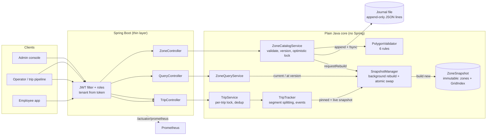
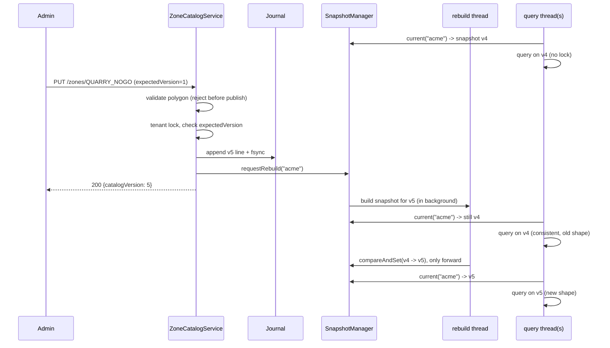

# Design note: Polygon Zones at Scale

## 1. Architecture

The core (everything under `core/`) has no framework code, so every rule is tested with plain JUnit, without a web server or database. Spring only adds HTTP, security and metrics.

## 2. Hardest flow: a live edit while queries keep running

A reader calls `current()` once and uses only that object, so it sees either v4 or v5, never a half-built index or a mix of the two. The swap is a single `AtomicReference.compareAndSet`, so readers never wait for a rebuild.

## 3. Consistency model

Writes for one tenant are serialised by a per-tenant lock and get a strictly increasing catalog version. A write is acknowledged only after it is durable (fsync). Reads are snapshot-consistent: every answer is computed from exactly one immutable catalog version, and the response says which one. The live index trails the latest write by the rebuild time (about 20 ms for 5,000 polygons in the benchmark). That lag is exported as `zones_index_pending_versions` and `zones_index_staleness_seconds`. A caller who needs to read their own write passes `waitForVersion` (or an explicit `catalogVersion`). Versions only move forward on a node.

## 4. Key decisions

| Decision | Choice | Why |
|---|---|---|
| Distance method | Haversine on a sphere (R = 6,371,008.8 m); polygon edges and trip segments are straight lines in lat/lng | Matches how GeoJSON stores shapes. At Bengaluru's latitude, a 10 km edge drawn straight in lat/lng is at most ~0.45 m from the great circle (L²·tan φ / 8R), and a 300 m GPS segment is off by less than 1 mm. Both are far below GPS error (3–10 m). The sphere vs ellipsoid error is up to 0.3% of a distance, but it is the same on every run, so billing stays reproducible. |
| Boundary rule | A polygon is a closed set: on an edge, a vertex, or a hole's edge counts as inside. Tolerance is 1e-9° (~0.1 mm). | Explicit and tested. It is above double rounding error (~1e-14°) and below anything physical. |
| Spatial index | Uniform grid with 0.01° (~1.1 km) cells; zones covering more than 4,096 cells go to an "oversized" list | One hash lookup per ping, a simple and fast rebuild, and memory that is easy to predict. An R-tree is better when sizes vary wildly; the oversized list covers that case. |
| Segment splitting | Collect every edge-crossing fraction `t`, sort them, then classify each piece by its **midpoint** | Vertex touches, collinear runs along an edge, and shared borders all work with no special cases. Over-splitting is harmless; missing a split would be a bug. |
| Overlapping tariff zones | Every metre goes to exactly one billable zone: highest `priority`, ties broken by `zoneId` | The parts always add up to the total, and the result is deterministic. |
| Rounding | Doubles in metres; round once at the end to whole metres; parts use largest-remainder | `30.400 + 11.600 = 42.000` exactly. No disputes over 0.001 km. |
| Trip consistency | Tariff/airport/city zones are **pinned** at trip start; **no-go zones use the latest version** | A running fare never changes under the driver, and an invoice can be re-computed exactly. A safety rule must apply the moment it is published. |
| Live edits | Full background rebuild, coalesced, atomic swap | Simple and provably consistent. A rebuild takes ~18 ms for 5,000 zones (see README). |
| Storage | Append-only journal (one JSON line per zone version) + in-memory copy | Old versions are free (nothing is overwritten), it survives crashes, and it means one-command startup with no DB to run. The `ZoneRepository` interface allows swapping in Postgres/PostGIS later. |

## 5. Complexity

Notation: N zones, V vertices in a zone, c cells a zone's box covers, k candidate zones in a cell.

| Operation | Time | Space |
|---|---|---|
| Validate one polygon | O(V log V + pairs that overlap in x); worst case O(V²) | O(V) |
| Build index | O(Σ c) | O(Σ c) ints + one map entry per non-empty cell |
| Point query | O(1) cell lookup + O(Σ V) over the k candidates | O(1) |
| One trip segment | O(cells in the segment's box + Σ V of candidates × pieces) | O(pieces) |
| Edit | O(V) validation + O(1) append; rebuild O(Σ c + N log N) in the background | one new snapshot |

**Where it stops scaling, and the next step:**
1. **Huge polygons.** Exact point-in-polygon is O(V), so a 4,096-vertex zone costs ~4,096 edge tests for every ping inside it. The next step is to classify grid cells as fully-inside, fully-outside, or boundary, so most pings skip the exact test.
2. **Very frequent edits on very large catalogs.** Every edit rebuilds the tenant's whole index (~18 ms for 5,000 zones). Above roughly 100k zones per tenant, the next step is copy-on-write rebuilds of only the cells the edited zone touches.
3. **Single node.** Snapshots are read-mostly and small, so every node can hold all of them. Trip state lives in memory on one node. The next step is to partition trips by `tripId` (consistent hashing) and keep trip state in Redis.
4. **Journal replay.** The whole file is replayed at startup. Past a few hundred thousand edits, the next step is periodic snapshots plus compaction, or a database.

## 6. Failure modes

| What fails | What the user sees | How the system recovers |
|---|---|---|
| Index rebuild throws (bad data, bug, out of memory) | Queries keep answering from the previous version; `/index/status` shows `pendingVersions > 0` and `consecutiveFailures` | Retry with exponential backoff + jitter (0.5 s up to 30 s); metrics `zones_index_rebuild_failures_total` and `zones_index_failing_tenants`; test `FailureInjectionTest.failedRebuildKeepsServingTheOldIndexThenRecovers` |
| Process killed during an edit (torn write) | That request got no 2xx, so the client retries | On restart the partial last line is cut off and every complete edit is replayed; the index is rebuilt before serving; test `tornLastWriteIsCutOffOnRestart` |
| Journal corrupted in the middle | Service refuses to start (health is down) | Operator restores from backup. The service never serves wrong zones; test `corruptionInTheMiddleRefusesToStart` |
| Disk full / write error | `503 STORAGE_UNAVAILABLE`; nothing is applied | File and memory never disagree (a failed in-memory apply also rolls back the written line) |
| Two admins edit the same zone | The second one gets `409 VERSION_CONFLICT` | Reload and re-apply; a retried request can never apply twice |
| Invalid polygon | `400 INVALID_POLYGON` with the reasons | Never reaches the index |
| Duplicate, late or shuffled pings | Counted as duplicate / outOfOrder; kilometres unchanged | Pings are sorted inside a batch and ordered by time per trip; test `replayingPingsChangesNothing` |
| Zone edited during a trip | Fare split unchanged for that trip; no-go uses the new shape | Version pinning; test `TripVersionPinningTest` |
| Expired or forged token, other tenant's data | 401, or 404 (an id from another tenant looks like it does not exist) | Tests in `SecurityAndTenantIsolationTest` |
| Server restart with live trips | In-progress trip state is lost (known gap, see README) | In production: keep trip state in Redis, or recompute from stored pings |
